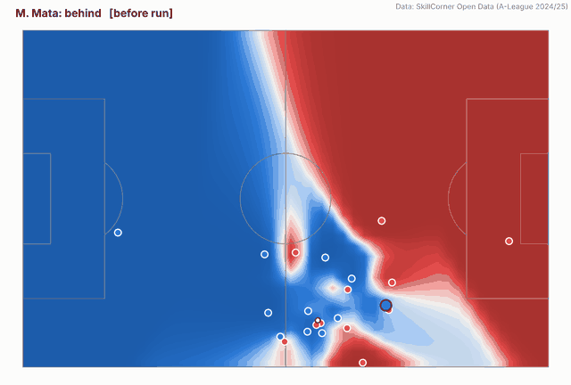
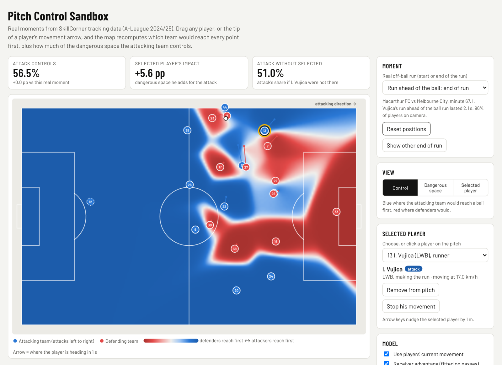
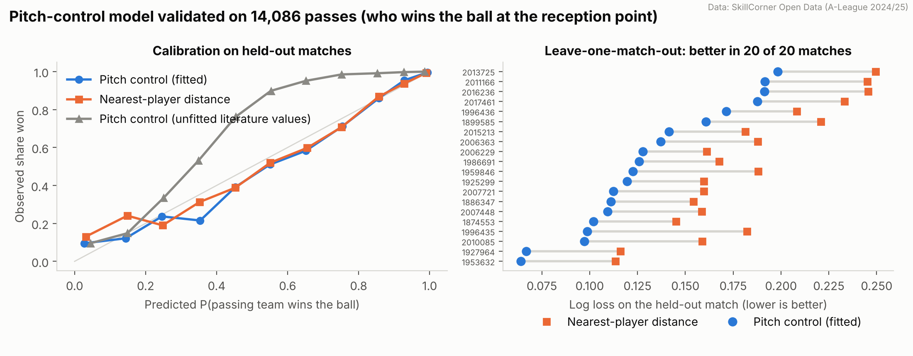
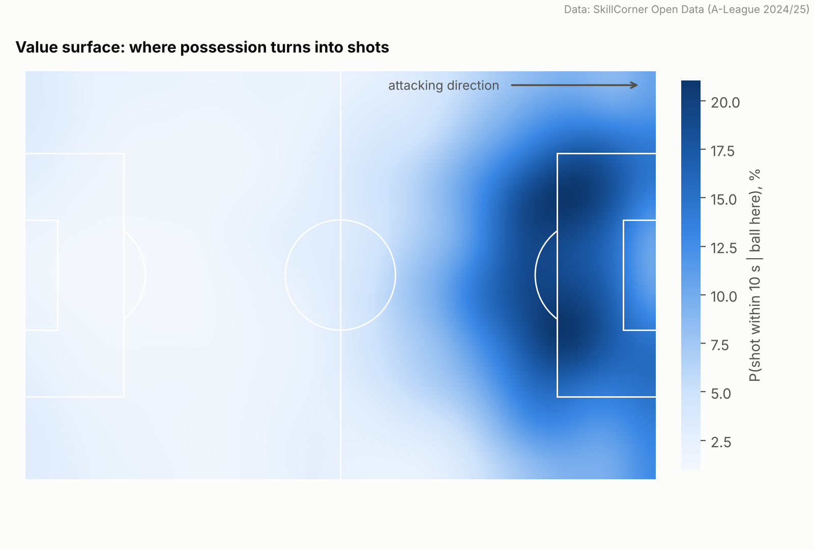
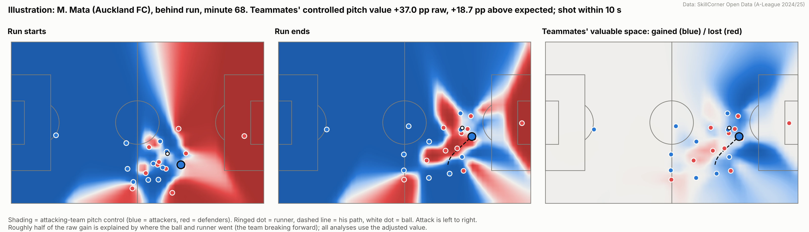
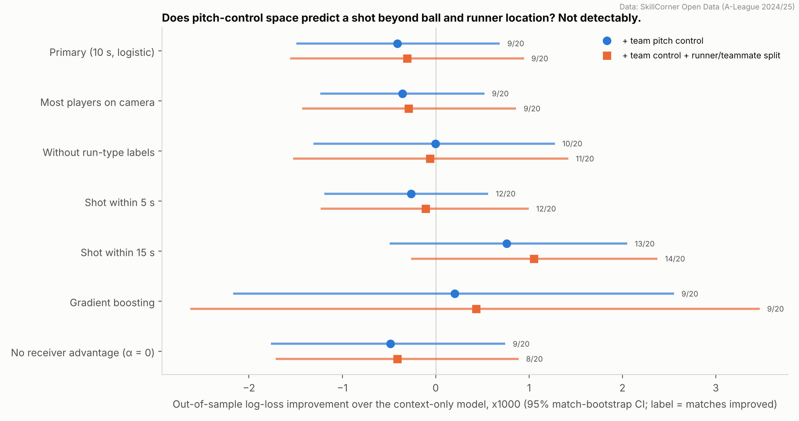
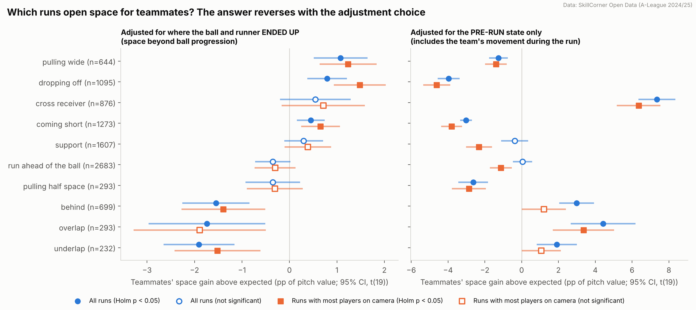
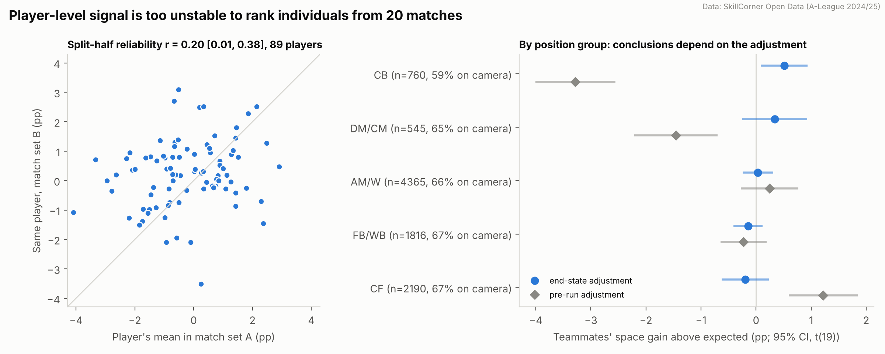

# Do Off-Ball Runs Create Space for Teammates?

**A leakage-controlled evaluation of pitch control on broadcast tracking data: 20 A-League 2024/25 matches, 9,898 off-ball runs**



*Live pitch control during an off-ball run in behind. Blue: area the attacking team would reach first; red: the defending team. The ringed player is the runner.*

**[▶ Open the interactive Pitch Control Sandbox](https://ridhimagupta4.github.io/offball-space/)**: drag players on real tracking frames and watch control and dangerous space recompute live.

---

## Summary

Pitch control and "space creation" are among the most widely used ideas in football tracking analytics. This project builds a pitch-control model from scratch, fits and validates it on real tracking data, and then tests two common claims: that space predicts chances, and that particular runs create space for teammates. Every predictive model is scored on matches it has never seen.

| Question | Finding | Key evidence |
|---|---|---|
| Can a fitted pitch-control model predict who wins a pass? | **Yes, clearly.** | Held-out log loss 0.128 vs 0.178 for a nearest-player baseline; better in **20 of 20** held-out matches (95% CI of gain 0.045 to 0.056); holds at every level of camera coverage |
| Does space around a run predict a shot beyond where the ball and runner are? | **No detectable gain.** | Out-of-sample log-loss change −0.0003 (95% CI −0.0016 to +0.0009). The data rule out any improvement larger than 0.39% of baseline log loss. Null in all seven analyses |
| Which run types open space for teammates? | **It depends on the adjustment.** | Under two defensible adjustment sets, 3 to 6 of ten run types (depending on the specification) are statistically significant in **opposite directions**. Coming short and pulling wide reverse in all five specifications tested |
| Can the metric rank individual players? | **No, not from 20 matches.** | Split-half reliability r = 0.20 (95% CI 0.01 to 0.38) |

The pitch-control model is solid, validated on held-out pass outcomes. The space metrics built on it carry far less information than they appear to, and run-type rankings derived from them depend on an analytical choice that the data cannot settle.

---

## Interactive sandbox

[](https://ridhimagupta4.github.io/offball-space/)

The sandbox (`docs/index.html`, a single self-contained page that makes no requests to other sites) runs the fitted model in the browser on 20 real moments: the start and end of one run of each type. Each moment is chosen by a fixed rule, namely the run with the most players on camera, not by its outcome.

**What you can do:**
- **Players:** drag any player; drag the tip of his movement arrow to change where he is heading; or remove him from the pitch.
- **Model:** switch the receiver advantage or players' movement on and off, and adjust reaction time, running speed and uncertainty.
- **Views:**
  - **Control:** who reaches each point first.
  - **Dangerous space:** control weighted by shot value.
  - **Selected player:** the space a single player adds or takes away.

**Readouts** give the share of valuable space the attacking team controls and the selected player's marginal impact. The JavaScript model reproduces the Python analysis to within 1 × 10⁻⁹ on every exported moment (`tests/test_explorer_parity.mjs`).

---

## 1. Data

- **[SkillCorner Open Data](https://github.com/SkillCorner/opendata)** (MIT licence): 20 matches from the Australian A-League 2024/25 (13 teams): broadcast tracking at 10 fps (≈1.2M frames) plus SkillCorner's *Dynamic Events*, which tag off-ball runs, player possessions, passes and shots. Data © SkillCorner, released jointly with PySport.
- **Broadcast tracking only observes players who are on camera.** On average 66% of player positions around the analysed runs are detected; the rest are extrapolated by SkillCorner. Every key result is therefore repeated on the best-tracked half of runs.
- Tracking files are verified against their Git-LFS SHA-256 checksums on download. Attacking direction is normalised per period and verified empirically: after normalisation, 100% of shots occur in the attacking half.

## 2. Pitch control: fitted and validated, not assumed

For any point *z* on the pitch, the model estimates the probability that the attacking team would control a ball arriving there. It is a smooth, fittable variant of Spearman (2018):

- **Time to intercept:** τᵢ(z) = r + ‖pᵢ + vᵢ·r − z‖ / vₘₐₓ. Player *i* keeps his current velocity for a reaction time *r*, then runs straight at speed vₘₐₓ.
- **Attacking control:** PC(z) = σ( α + logsumexpₐₜₜ(−τ/β) − logsumexp_def(−τ/β) )

The four parameters (r, vₘₐₓ, β, α) are fitted by maximum likelihood on **14,086 passes** with a recorded receiver or interceptor. The outcome is which team wins the ball where the next possession starts; it agrees with SkillCorner's pass-outcome label in 99.93% of cases. Player positions are taken at SkillCorner's pass frame. That timing is checked against the tracking: over 16,004 passes, median ball speed rises from about 3 m/s to pass speed (≈13 m/s) within 0.3 s of that frame (`results/pass_timing_check.csv`). Validation is leave-one-match-out: each match is scored by a model fitted on the other 19.



| Model (scored on held-out matches) | Log loss | Brier | AUC |
|---|---:|---:|---:|
| Base rate | 0.334 | 0.093 | n/a |
| Pitch control, unfitted literature values | 0.231 | 0.067 | 0.966 |
| Nearest-player distance (logistic) | 0.178 | 0.053 | 0.940 |
| **Pitch control, fitted** | **0.128** | **0.036** | **0.973** |

**What the fit shows:**
- **Stable parameters.** They barely move across the 20 folds: reaction time 0.86–0.88 s, effective speed 3.57–3.63 m/s, β 0.32–0.33 s.
- **Receiver advantage.** The bias α ≈ 1.26 gives the passing team about 3.5× the odds of winning a ball that a defender could reach equally fast. This plausibly reflects the receiver knowing where the pass is going.
- **Fitting matters.** The unfitted values (r = 0.7 s and vₘₐₓ = 5 m/s from Spearman 2018, with a neutral α) are badly overconfident.

**Robustness:**
- **Camera coverage.** The fitted model's advantage holds in every third of camera coverage. Log loss is 0.114 vs 0.154 where most players are detected, and 0.123 vs 0.178 where fewest are.
- **Causal inputs only.** Velocities are backward differences using only past positions. A centred difference, a common default, uses positions 0.3 s *after* the pass and flatters held-out log loss (0.123 instead of 0.128).
- **Caveat.** The target is the realised reception point, as in Spearman (2018), so absolute accuracy is optimistic. The comparison between models is fair, because all of them see identical information.

## 3. Which space is valuable

Space only matters where it leads to chances. Each pitch location is weighted by

> V(z) = P(the team in possession shoots within 10 s | ball at z)

V is estimated from 125,216 tracking frames on a 50 × 32 grid, normalised to each stadium's pitch size (104–106 m), with Gaussian smoothing and a beta prior at the base rate.

**Validation.** Scored on held-out matches, the surface predicts a shot within 10 s far better than the base rate: log loss 0.172 vs 0.209, AUC 0.83. The smoothing bandwidth was fixed in advance; alternatives from half to double it change held-out log loss by at most 0.0015 (`results/value_surface_validation.csv`).



**Nested estimation.** The surface used for any match never contains that match's own shots. In cross-validation, the held-out match uses a surface fitted without it, and every *training* match uses a surface fitted without both itself and the held-out match. This prevents in-sample target encoding inside the training folds.

## 4. Measuring space around a run

For each of SkillCorner's 9,898 tagged off-ball runs, value-weighted pitch control is computed at the start and end of the run, twice: with the runner, and with the runner removed. This separates:

- **Runner's own space:** the value the runner personally controls.
- **Teammates' space gain:** the change in value controlled by everyone else while he runs. If a run drags defenders away, this should rise.



*Illustration: the run with the largest above-expected teammate gain among runs that were followed by a shot, lasted at least 2.5 s and had at least 75% of players on camera.*

Raw gains are dominated by the whole team moving up the pitch, so the analyses use gains **above expected**: the residual from a cross-fitted, additive spline model of the game state (Section 5b).

## 5. Results

### 5a. Space does not predict shots beyond location

**Outcome:** the runner's team shoots within 10 s **after** the run ends. Runs with a shot *during* the run are excluded, so every input precedes the outcome window (n = 9,695; base rate 10.3%).

Three nested models are compared with leave-one-match-out cross-validation:

| Model | Inputs |
|---|---|
| **B0 Context** | Ball and runner location at run start and end, run duration, run type, minute, game state, venue |
| **B1 + Team space** | B0 plus the team's value-weighted pitch control at start and end |
| **B2 + Runner/teammate split** | B1 plus the same quantity without the runner |

All three are logistic regressions on cubic B-splines. The L2 penalty is chosen *inside* each training fold by grouped 4-fold CV, so the held-out match never informs it.



| Analysis | B1 vs B0: log-loss gain ×1000 [95% CI] | B2 vs B0: log-loss gain ×1000 [95% CI] |
|---|---:|---:|
| Primary (10 s, logistic) | −0.41 [−1.49, +0.69] | −0.30 [−1.56, +0.94] |
| Runs with ≥ 68% of players on camera | −0.36 [−1.23, +0.52] | −0.29 [−1.43, +0.86] |
| Without SkillCorner run-type labels | −0.00 [−1.31, +1.28] | −0.06 [−1.53, +1.42] |
| Shot within 5 s | −0.26 [−1.19, +0.56] | −0.11 [−1.23, +1.00] |
| Shot within 15 s | +0.76 [−0.49, +2.05] | +1.05 [−0.26, +2.38] |
| Gradient boosting (fixed hyperparameters) | +0.20 [−2.17, +2.55] | +0.43 [−2.63, +3.47] |
| No receiver advantage in pitch control (α = 0) | −0.48 [−1.76, +0.75] | −0.41 [−1.71, +0.89] |

Intervals are 95% match-level percentile bootstraps. With only 20 matches, small-sample cluster t(19) intervals are also computed. They are 9–12% wider, change no conclusion, and are in `results/runs_cv_comparisons_*.csv`.

**How large an effect is ruled out.** Taking the wider of the two intervals, the upper bound for B2 over B0 is 0.39% of the baseline log loss in the primary analysis and at most 1.3% across all seven analyses. Any predictive value that space adds is, at best, very small.

**Could the pipeline have detected an effect?** Yes. As a positive control, the identical pipeline compares the context model with and without where the ball and runner ended up, which certainly matters. Adding them improves held-out log loss by 0.0128 (95% CI 0.0093 to 0.0163), in 18 of 20 matches. That is about 12 times the largest gain still compatible with the data for space (`results/positive_control.csv`). The null for space is therefore not a symptom of an insensitive method.

**Calibration.** All three models are well calibrated out of sample: primary AUC 0.802, calibration intercepts within ±0.01, slopes 0.95–0.98 (at most slight overfitting).

**Context-adjusted GLM.** The teammate-space-gain odds ratio is 1.17 per SD (95% CI 0.93 to 1.46; Holm-adjusted p = 0.51). The GLM uses centred natural splines and match-clustered errors with a t(19) reference. The direction is as expected, but the effect is not distinguishable from zero.

**Interpretation.** At this resolution, almost everything space says about the next few seconds is already contained in *where the ball and the runner end up*. Pitch control remains a good description of a moment; it does not add measurable predictive value for short-horizon shots. The 15-second horizon shows the largest point estimate, which makes longer-horizon outcomes the natural place to look next.

### 5b. Run types: the answer reverses with the adjustment

To compare run types, the teammate gain must be adjusted for the game situation. Two adjustment sets are defensible, and both are reported:

- **End-state adjustment:** includes where the ball and runner *ended up*. It isolates space beyond ball progression, but ball and runner end positions are partly *caused* by the run, so it conditions on a mediator.
- **Pre-run adjustment:** uses only the state at the start of the run. It keeps the run's full effect, but it also credits the run with the whole team's simultaneous movement (confounding).

Both use a cross-fitted additive spline ridge model that deliberately excludes run type. Inference uses match-clustered errors with a t(19) reference and a Holm correction across the ten run types.



| Run type (n) | End-state adjusted (pp) [95% CI] | Pre-run adjusted (pp) [95% CI] |
|---|---:|---:|
| Pulling wide (644) | **+1.08** [+0.51, +1.64] | **−1.26** [−1.76, −0.75] |
| Dropping off (1,095) | **+0.80** [+0.38, +1.21] | **−3.96** [−4.55, −3.37] |
| Coming short (1,273) | **+0.45** [+0.16, +0.74] | **−3.02** [−3.34, −2.69] |
| Behind (699) | **−1.55** [−2.26, −0.84] | **+2.99** [+2.05, +3.94] |
| Overlap (293) | **−1.74** [−2.97, −0.51] | **+4.43** [+2.67, +6.18] |
| Underlap (232) | **−1.90** [−2.65, −1.16] | **+1.91** [+0.82, +3.00] |

*Bold: Holm-adjusted p < 0.05. The table lists the six types that are significant in opposite directions in the primary analysis; all ten are in the figure and in `results/run_types.csv`.*

- **End-state adjustment.** Runs that withdraw or widen (pulling wide, dropping off, coming short) coincide with teammates gaining valuable space. Runs into depth (behind, overlap, underlap) coincide with teammates losing it. The pattern holds on the best-tracked runs, where overlap falls just short of significance (Holm p = 0.053). It also holds without the receiver-advantage term: all ten run types keep their direction, magnitudes shrink by about a quarter (median 23%), and four of the six remain significant in opposite directions. A plausible football reading: withdrawing runs drag markers away from dangerous zones, while depth runs pull the runner's marker, and often a covering defender, into the area teammates would otherwise attack.
- **Pre-run adjustment.** The ranking largely reverses: across all ten run types, the two adjustments' means correlate at −0.47. Depth runs coincide with the whole team advancing into valuable areas, which this adjustment credits to the run.
- **How robust is the reversal?** It was checked in five specifications:
  - all runs;
  - the best-tracked runs;
  - no receiver advantage (α = 0);
  - each moment counted once (63% of runs overlap another run by the same team);
  - runs with a shot during them included.

  The number of run types that are significant in opposite directions ranges from 3 to 6, and the rank correlation from −0.47 to −0.62. Coming short and pulling wide reverse in all five specifications (`results/run_type_reversals.csv`).
- **Implication.** Neither set identifies the causal effect of a run. A "space creation by run type" chart can be made to support either story. Answering the causal question needs an explicit model of how defenders would have moved without the run.

### 5c. Players and positions



**Split-half reliability.** Each player's matches are split into two halves (89 players with at least 15 runs in each). A player's adjusted space gain in one half barely predicts the other: r = 0.20 (95% CI 0.01 to 0.38), or 0.34 at full length by the Spearman–Brown formula.

**The pre-run metric looks more reliable (r = 0.54), plausibly for the wrong reason.** It likely reflects stable *roles*, such as who makes forward runs when the team advances.

**Position groups.** Results show the same dependence on adjustment. Centre-backs are +0.51 pp under the end-state adjustment (not significant after Holm correction) and −3.28 pp under the pre-run adjustment. **Neither version supports ranking individual players from 20 matches**, so no player leaderboard is presented.

## 6. Validity and leakage controls

| Risk | Control |
|---|---|
| Autocorrelated frames within a match | All validation is leave-one-match-out; uncertainty from a match-level bootstrap or match-clustered errors |
| Test match informing the model | Pitch-control parameters, value surfaces and regularisation are all re-estimated without the held-out match; run features are rebuilt for every fold |
| In-sample target encoding in training folds | Training matches use a value surface that excludes their own shots (nested cross-fitting) |
| Look-ahead in kinematics | Velocities use backward differences only, verified by a unit test |
| Hindsight features | SkillCorner's `targeted`, `received`, `lead_to_shot`, phase-of-play labels and simultaneous-run counts are never model inputs; run-type labels are tested as a sensitivity |
| Outcome overlapping inputs | The outcome window opens strictly after the run ends; runs with a shot during them are excluded |
| Off-camera extrapolation | Results repeated on runs with ≥ 68% of players detected; pitch-control validation by camera-coverage third; detection-slope tests for all run types (Holm-corrected) |
| Unverified inputs | Pass timing checked against ball speed; value surface validated on held-out matches |
| Pass-specific model term applied to open space | Full rebuild with the receiver advantage removed (α = 0) |
| Few clusters (20 matches) | t(19) reference distribution for cluster-robust inference; model comparisons reported with both bootstrap and t(19) intervals |
| Multiple comparisons | Holm correction across run types, position groups and GLM terms |
| Model-class and horizon dependence | Repeated with gradient boosting, and at 5 s and 15 s |
| Null result from an insensitive method | Positive control: the same pipeline clearly detects a variable known to matter |
| Mediator adjustment | Run-type analysis reported under both end-state and pre-run adjustment |
| Simultaneous runs and sample selection | Run-type analysis repeated with each moment counted once, and with runs that had a shot during them included |
| Pitch-size differences (104–106 m) | Grids scaled to each match's pitch; value surface on normalised coordinates |
| Data-type errors | Boolean flags are type-checked; a regression test guards a string-vs-boolean direction error |
| Reproducibility | Pinned dependencies and a deterministic pipeline: on the pinned environment, re-running it from a fresh download reproduces every results file exactly |

The leakage, timing, data-type and input checks are enforced by `tests/` (20 Python tests, including a check that every headline number in this README matches the results files, plus JavaScript parity and stress tests for the sandbox). The statistical choices in the table are documented in the code.

## 7. Limitations

- **Scale.** 20 matches from one league: enough to validate pitch control and detect moderate predictive effects, but not enough for stable player-level estimates.
- **Broadcast tracking.** About a third of player positions are extrapolated. SkillCorner's extrapolation may use information from later video frames, a source of look-ahead that cannot be removed downstream. The best-tracked-runs sensitivity mitigates this but cannot exclude it.
- **Pitch-control model.** It ignores body orientation, ball height and flight time. Parameters are fitted on passes, which may differ from the "space" concept used for runs (see the α = 0 sensitivity).
- **Adjustment uncertainty.** Above-expected gains are residuals from a cross-fitted model. The uncertainty of that adjustment model is not propagated, though it is small relative to between-match variation at this sample size.
- **Run labels.** SkillCorner's run tagging and run-type labels are themselves model outputs and are taken as given. Runs made off camera may be tagged less often, so the sample of runs may under-represent them.
- **Sandbox surface.** The sandbox uses the value surface estimated from all 20 matches. It is a visual explanation of the model, not part of the validation.

## 8. Future work

1. **Counterfactual defence:** model defender movement conditional on the absence of a run, to estimate run-level causal space creation.
2. **Full optical tracking:** replicate on full-pitch tracking (for example the DFL/Sportec open matches) to remove broadcast extrapolation.
3. **Denser outcomes:** use longer horizons and an out-of-fold possession-value model.
4. **Pass-specific pitch control:** incorporate ball flight time and player orientation.

---

## Reproducing the analysis

```bash
pip install -r requirements.txt   # Python 3.13, pinned versions
./fetch_data.sh                   # SkillCorner open data (~1.8 GB), checksum-verified (Linux and macOS)
./run_all.sh                      # full pipeline (~90 min on 2 cores), sandbox build, then all tests
                                  # (uses python3; set PYTHON=... to use another interpreter)
```

| Path | Contents |
|---|---|
| `src/ingest.py` | Tracking JSONL → compact per-match arrays |
| `src/core.py` | Loading, direction normalisation, causal velocities, pitch-control model |
| `src/build_passes.py` | Pass dataset (receiver or interceptor recorded) |
| `src/fit_pitch_control.py` | Pitch-control fitting, leave-one-match-out validation, camera-coverage check |
| `src/validate_data_assumptions.py` | Pass-timing check and held-out validation of the value surface |
| `src/build_runs.py` | Value surfaces and fold-aware, nested run features (`ALPHA0=1` for the α = 0 sensitivity) |
| `src/validate_runs.py` | Nested out-of-sample models, calibration, sensitivity analyses, GLM |
| `src/positive_control.py` | Checks that the same pipeline detects a real effect |
| `src/descriptive.py` | Run types and their robustness checks, camera coverage, positions, player reliability |
| `src/figures.py` | All figures |
| `src/export_explorer.py` | Real moments, fitted model and reference values for the sandbox |
| `explorer/` | Sandbox source: `pc.js` (model), `template.html` (page), `data.js` (exported moments), `fonts/`, `build.py` |
| `docs/index.html` | Built, self-contained sandbox page (served by GitHub Pages) |
| `tests/` | Leakage, timing, data-type, README-consistency and JavaScript-parity tests |
| `results/` | Every table behind the figures and this README |

## References

- Spearman, W. (2018). *Beyond Expected Goals.* MIT Sloan Sports Analytics Conference.
- Fernández, J. & Bornn, L. (2018). *Wide Open Spaces: A statistical technique for measuring space creation in professional soccer.* MIT Sloan Sports Analytics Conference.
- SkillCorner. *Open Data* and *Dynamic Events* specifications. github.com/SkillCorner/opendata

## Acknowledgements

Tracking and event data: **SkillCorner**, released with **PySport** as open data.

## Licence

Code, figures and text: [MIT](LICENSE). The sandbox embeds a small excerpt of SkillCorner Open Data (MIT) and the Barlow fonts (SIL Open Font License); see [THIRD_PARTY_NOTICES.md](THIRD_PARTY_NOTICES.md). The raw tracking data is not redistributed: `fetch_data.sh` downloads it from SkillCorner.

---

**Ridhima Gupta** · MSc Statistics with Data Science, University of Edinburgh · [github.com/RidhimaGupta4](https://github.com/RidhimaGupta4)
